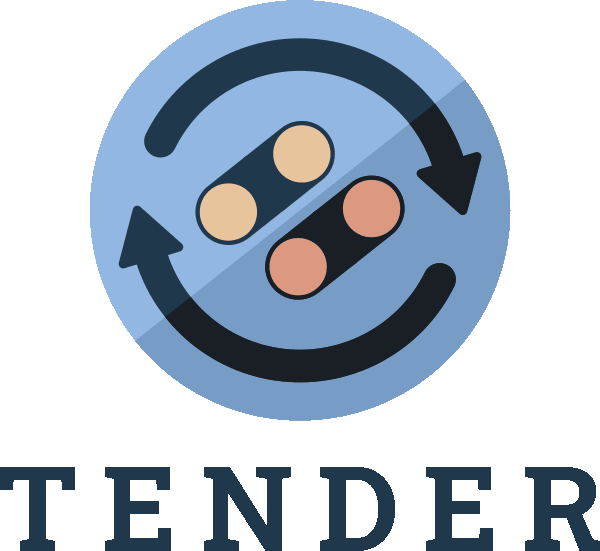
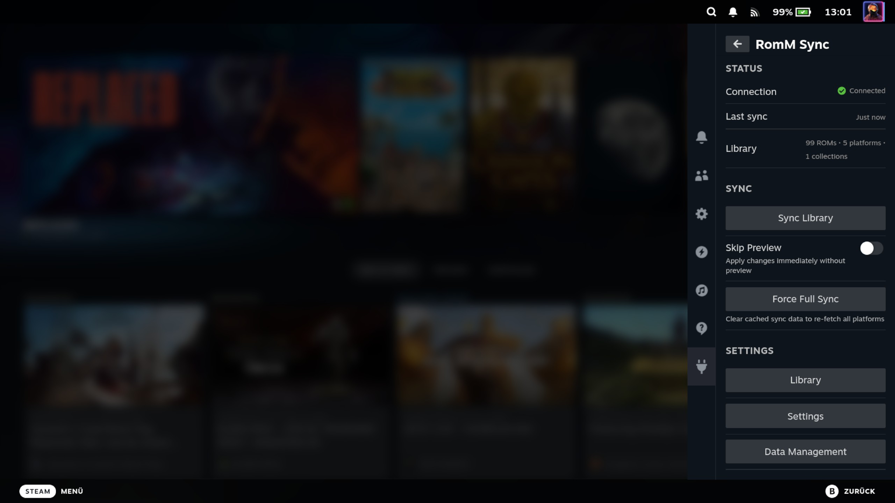
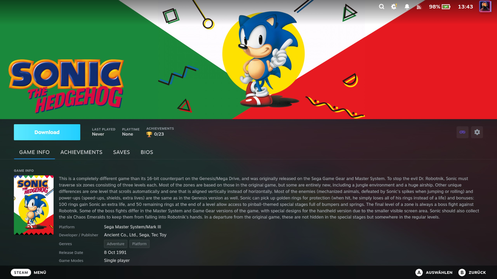
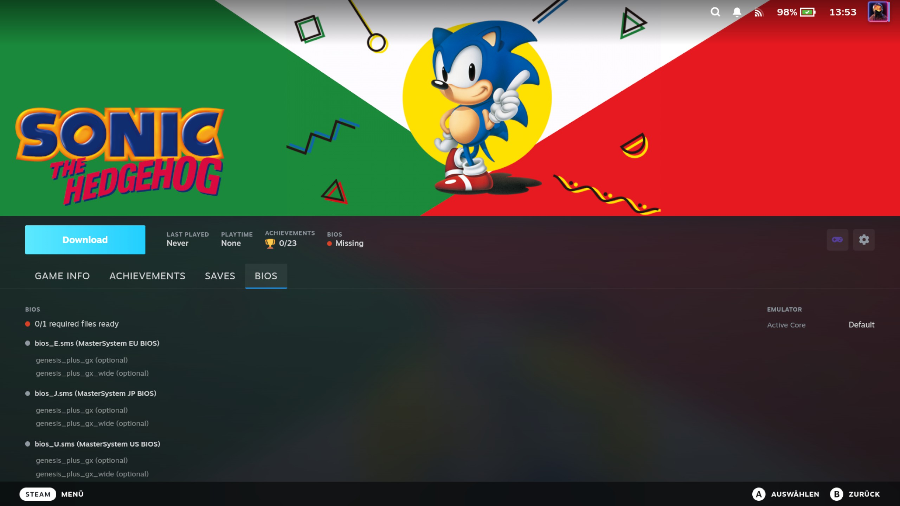
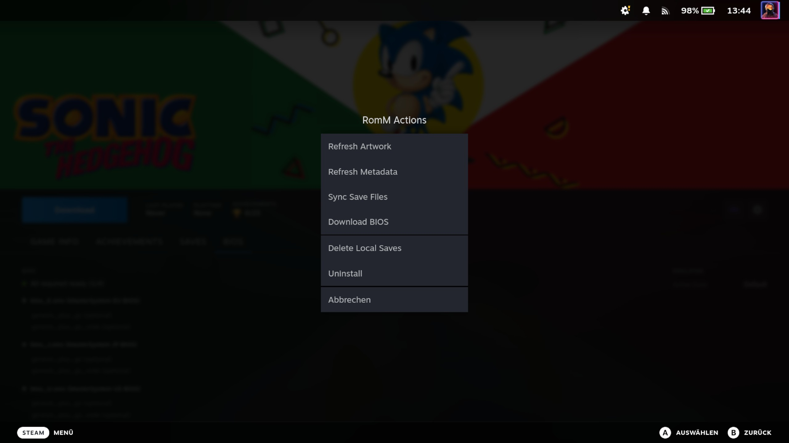

<div align="center">

<picture>
  <source media="(prefers-color-scheme: dark)" srcset="assets/lockup-animated-dark.gif">
  
</picture>

<h3>Your RomM library, running native in Steam</h3>

[Getting Started](docs/user-guide/getting-started.md) ·
[Configuration](docs/user-guide/configuration.md) ·
[Syncing](docs/user-guide/syncing-your-library.md) ·
[Managing Games](docs/user-guide/managing-games.md)

[BIOS &amp; Cores](docs/user-guide/bios-management.md) ·
[Save Sync](docs/user-guide/save-sync.md) ·
[Troubleshooting](docs/user-guide/troubleshooting.md)

<a href="docs/index.md"></a>
<a href="https://github.com/manu0623/arcoon-deck/releases/latest"></a>
<a href="https://github.com/manu0623/arcoon-deck/stargazers"></a>
<a href="https://github.com/manu0623/arcoon-deck/releases"></a>
<a href="https://github.com/rommapp/romm/releases"></a>

</div>

A [Decky Loader](https://decky.xyz/) plugin that syncs your self-hosted [RomM](https://github.com/rommapp/romm) library
into Steam as non-steam shortcuts. Games appear directly in your Steam library, launch through
[RetroDECK](https://retrodeck.net/), and can keep their saves in sync across devices through your RomM server.

**Arcoon Deck is a modification of [Tender](https://github.com/danielcopper/romm-tender)**, the plugin by
[Daniel Copper](https://github.com/danielcopper) that this one is built on and unreservedly credits. The library sync,
Steam shortcut layer, artwork, BIOS management, ROM downloads and the save-sync engine are his design and his code.
What this fork changes is which platforms' saves travel — see [Origin & Attribution](docs/attribution.md).
_(Tender is named after the railway car behind a steam locomotive, or the boat that shuttles out to a ship at anchor.)_

> **Pre-1.0 (v0.x).** The feature set isn't complete yet, but save sync is no longer cartridge-only: PS2 memory
> cards, PSP save folders, GameCube card entries, Wii title folders and the Switch/3DS title trees carry across
> devices now. The [support matrix](docs/user-guide/save-sync-support-matrix.md) has the per-system detail, and it is
> the page to read before assuming a system syncs.

---

> [!NOTE]
> **How this is built.** The code is written by an AI coding agent working under the maintainer's direction. The
> architecture, the design decisions and the review are the maintainer's, and every save-path change is verified on
> real hardware — two Deck-class handhelds and a RomM server — by making a save on one device and watching the other
> load it. Upstream Tender says the same of itself, which is why neither project is on the Decky store.

## Features

- **Library sync** — Pulls the platforms and collections you pick from your RomM server into Steam as non-steam
  shortcuts with RomM cover art; later runs are incremental and preview what will change before touching anything
- **SteamGridDB artwork** — Add a free [SteamGridDB](https://www.steamgriddb.com/) key to get hero banners, logos, wide
  capsules and custom icons, with a manual picker for games that don't match automatically
- **Save sync** — Opt-in save syncing across devices through your RomM server, automatically before launch and after you
  quit; identical saves resolve silently, and if both sides genuinely changed you decide which one wins
  ([not every system syncs yet](docs/user-guide/save-sync-support-matrix.md))
- **Save slots & version history** — Multiple named save profiles per game, plus per-file version history with restore
- **ROM downloads** — Download on demand with progress, pause/resume/cancel, and a managed queue
- **BIOS management** — Per-platform BIOS status, download all or only what your active core requires, hash-verified
  against a bundled registry, and delete them again when you're done
- **Game detail page** — Replaces Steam's page for synced games: RomM metadata, RetroAchievements progress, playtime,
  install and BIOS status, save management, and per-game actions
- **Multi-disc & multi-version** — Pick the disc for multi-disc games and switch between regions or revisions of the
  same game, right from its Steam page
- **Emulator cores** — Set the core per system, or override it for a single game
- **Steam Input** — Pick a Steam Input mode (Default / Force On / Force Off) and apply it to every shortcut the plugin
  created
- **RetroArch input fix** — Spots the `input_driver` value that breaks controller navigation in RetroArch's menus and
  repairs it in one tap
- **Follows RetroDECK moves** — Moved RetroDECK to another drive? The ROMs, BIOS files and saves the plugin manages are
  relocated and your shortcuts repointed — nothing needs re-downloading
- **Cleanup tools** — Remove shortcuts per platform or all at once, uninstall ROMs, and clear orphaned grid images

## Screenshots

|                Quick Access panel                |                    Game detail page                    |
| :----------------------------------------------: | :----------------------------------------------------: |
|  |  |
|               **BIOS management**                |                  **Per-game actions**                  |
|        |          |

## Requirements

- [Decky Loader](https://decky.xyz/) on your Steam Deck or Linux HTPC — the plugin lives in Steam's gamepad UI, so it
  works in the Deck's Game Mode **or** in Big Picture Mode on any Linux PC
- A running [RomM](https://github.com/rommapp/romm) server, **version 4.9.0 or newer** (the plugin stays inert against
  older servers)
- [RetroDECK](https://retrodeck.net/) for launching games

## Installation

**This fork has no published releases yet.** Build the plugin from this checkout and install the zip from the file:

```bash
git clone https://github.com/manu0623/arcoon-deck.git
cd arcoon-deck && decky plugin build    # writes the plugin zip to out/
```

Then, with **Developer mode** enabled (Decky tab → gear icon → **General → Other**), open Decky's **Developer** tab
and use **Install Plugin from ZIP File**.

Once a release is cut here it will be installable by URL the same way, from
`https://github.com/manu0623/arcoon-deck/releases/latest` — pasting that URL is then also how you update.

Looking for Tender itself, with its releases and its support? That is
[danielcopper/romm-tender](https://github.com/danielcopper/romm-tender), documented at the
[upstream site](https://danielcopper.github.io/romm-tender/).

> Full step-by-step instructions, including first-time setup, are in
> [Getting Started](docs/user-guide/getting-started.md).

## Quick start

1. Open the Quick Access Menu and select **Arcoon Deck**
2. In **Settings**, enter your RomM server URL and credentials, then hit **Test Connection**
3. In **Platforms**, enable the platforms you want to sync
4. Open **Sync** and hit **Sync Library** — look over the changes it works out, then **Apply Sync**, and your ROMs
   appear as non-steam shortcuts

See the [User Guide](docs/user-guide/syncing-your-library.md) for syncing details,
[save sync](docs/user-guide/save-sync.md), and
[BIOS management](docs/user-guide/bios-management.md).

## Contributing

Build from source, run the tests, and read the architecture reference on the documentation site:

- [Development setup](docs/contributing/development.md)
- [Frontend dev loop](docs/contributing/frontend-dev-loop.md) — live-reload the UI
  into a windowed Big Picture on the Deck, no Game Mode switching
- [Backend architecture](docs/architecture/backend-architecture.md)
- [Origin & Attribution](docs/attribution.md) — what this fork changed, and what it owes to Tender

[](https://github.com/manu0623/arcoon-deck/actions/workflows/ci.yml)
[](https://sonarcloud.io/summary/new_code?id=danielcopper_romm-tender)
[](https://sonarcloud.io/summary/new_code?id=danielcopper_romm-tender)
[](https://sonarcloud.io/summary/new_code?id=danielcopper_romm-tender)
[](https://sonarcloud.io/summary/new_code?id=danielcopper_romm-tender)
[](https://sonarcloud.io/summary/new_code?id=danielcopper_romm-tender)

## Acknowledgments

This plugin stands on the shoulders of some great projects:

- **[Tender](https://github.com/danielcopper/romm-tender) by [Daniel Copper](https://github.com/danielcopper)** — the
  plugin Arcoon Deck modifies. Every part of this project that is not listed in
  [Origin & Attribution](docs/attribution.md) is his work, released under the GPL-3.0
- [RomM](https://github.com/rommapp/romm) — the self-hosted ROM manager at the heart of this plugin. RomM provides the
  library, metadata, cover art, and save file storage that makes the entire sync experience possible
- [RetroDECK](https://retrodeck.net/) — the all-in-one emulation solution for Steam Deck that bundles ES-DE, RetroArch,
  and standalone emulators into a single flatpak. Our entire launch chain runs through RetroDECK
- [Decky Loader](https://decky.xyz/) — the plugin framework that makes all of this possible
- [Valve](https://www.valvesoftware.com/) — for the Steam Deck, SteamOS, and an open enough platform to build on
- [Unifideck](https://github.com/ma3ke/unifideck) — inspiration for game detail page injection techniques and gamepad
  navigation patterns
- [MetaDeck](https://github.com/EmuDeck/MetaDeck) — inspiration for store patching patterns used in metadata display on
  non-Steam shortcuts
- [Argosy](https://github.com/rommapp/argosy-launcher) — RomM's Android device-sync client. Its baseline-anchored
  save-conflict handling — client-side detection layered over RomM's negotiate transport, with a keep-local/keep-remote
  prompt on genuine divergence — validated the posture this plugin's save sync takes
- [Grout](https://github.com/rommapp/grout) — RomM's Linux handheld client. Its 409-driven upload reconciliation (POST
  with overwrite=false, downgrading to a download when the local save is unchanged and surfacing a conflict when it
  diverged) informed this plugin's negotiate upload and conflict path

## License

GPL-3.0, inherited from [Tender](https://github.com/danielcopper/romm-tender): Arcoon Deck is a derivative work of
it and is distributed under the same terms, with the original copyright notices kept. This is an independent
project and is not affiliated with, endorsed by, or sponsored by Tender's author, the RomM project or Valve
Corporation.
