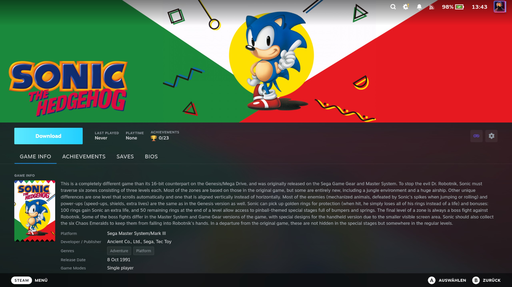

# Arcoon Deck { .hero-title }

A [Decky Loader](https://decky.xyz/) plugin that syncs your self-hosted [RomM](https://github.com/rommapp/romm) ROM
library into Steam as Non-Steam shortcuts. Games launch through [RetroDECK](https://retrodeck.net/).

**Arcoon Deck is a modification of [Tender](https://github.com/danielcopper/romm-tender)** — the plugin by
[Daniel Copper](https://github.com/danielcopper) this one is built on. The library sync, artwork, BIOS management, ROM
downloads and save-sync engine are his design and his code; what this fork changes is which platforms' saves travel,
described in [Origin & Attribution](attribution.md).

- Browse your entire RomM library directly from Steam's Gaming Mode
- Download ROMs on-demand with cover art, hero banners, logos, and metadata
- Manage BIOS files for systems that require them
- Sync save files between devices through your RomM server — including the card and title-folder systems below

!!! note "Pre-1.0 (v0.x)"

    The feature set isn't complete yet, but save sync is no longer cartridge-only: PlayStation 2 memory cards, PSP save
    folders, GameCube card entries, Wii title folders and the Switch/3DS title trees all carry across devices now. The
    [support matrix](user-guide/save-sync-support-matrix.md) has the per-system detail, and it is the page to read before
    assuming a system syncs.

!!! info "How this is built"

    The code is written by an AI coding agent working under the maintainer's direction. The architecture, the design
    decisions and the review are the maintainer's, and changes are smoke-tested on real hardware — two Deck-class
    handhelds and a RomM server — before they ship. The same statement holds for upstream Tender, which is why neither
    project is on the Decky store.

## Origin & Attribution

Full credit belongs to **[Tender](https://github.com/danielcopper/romm-tender)**, by
**[Daniel Copper](https://github.com/danielcopper)**, released under the **GNU GPL-3.0**. Arcoon Deck is an AI-assisted
modification of that project, not a rewrite: it keeps Tender's license, its architecture and its history, and this
repository's history contains the fork point it starts from.

What this fork is responsible for — the save-sync work that made the platforms below travel — is listed on
**[Origin & Attribution](attribution.md)**, together with what came from upstream and what to do if you are looking for
the original project instead of this fork.

## User Guide

1. **[Getting Started](user-guide/getting-started.md)** — Prerequisites, installation, and first-time setup
2. **[Configuration](user-guide/configuration.md)** — Connection settings, SteamGridDB API key, Steam Input, debug
   options
3. **[Syncing Your Library](user-guide/syncing-your-library.md)** — How sync works, per-platform toggles, collections,
   artwork
4. **[Managing Games](user-guide/managing-games.md)** — Game detail panel, downloading ROMs, uninstalling, refreshing
   metadata
5. **[BIOS Management](user-guide/bios-management.md)** — What BIOS files are, checking status, downloading per-platform
6. **[Save Sync](user-guide/save-sync.md)** — Auto-sync, conflict resolution modes, manual sync, failed sync retries
7. **[Save File Extensions](user-guide/save-file-extensions.md)** — Which save file extensions RetroDECK's cores
   produce, and the record of the original extension decision
8. **[Save Sync Support Matrix](user-guide/save-sync-support-matrix.md)** — What syncs today, what's planned, and what
   doesn't fit the per-game model
9. **[RetroDECK Path Migration](user-guide/retrodeck-path-migration.md)** — Moving your RetroDECK installation between
   storage locations
10. **[Troubleshooting](user-guide/troubleshooting.md)** — Common issues, fixes, Danger Zone explained

## Technical Reference

Developer-oriented documentation for contributors and those interested in the internals.

- **[Steam Non-Steam Shortcuts](architecture/steam-non-steam-shortcuts.md)** — AddShortcut API, VDF format, app ID
  generation
- **[QAM Panel](architecture/qam-panel.md)** — Pages and their widths, the wide-page frame, list-and-detail navigation,
  notices and their homes
- **[Backend Architecture](architecture/backend-architecture.md)** — Service/adapter architecture, dependency diagram,
  boundary enforcement
- **[Config Source Parsers](architecture/config-source-parsers.md)** — One-parser-per-source principle, source catalog,
  parser layout template for local config/metadata files
- **[Core and Emulator Selection](architecture/core-emulator-selection.md)** — Per-game vs per-system core overrides,
  the single read seam, and how the chosen core is baked into the launch command
- **[Development](contributing/development.md)** — Developer setup, building, testing, dev reload
- **[Save File Sync Architecture](architecture/save-file-sync-architecture.md)** — Three-way conflict detection, session
  tracking, state schema, device registration
- **[Steam Remote Play and Cross-Device Shortcuts](architecture/steam-remote-play.md)** — Remote Play discovery
  protocol, phantom shortcuts, detection APIs
